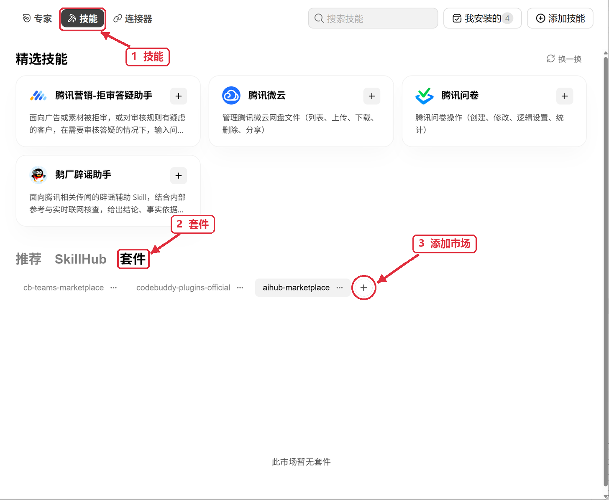

# AIhub Marketplace

这个市场提供 AIhub 创作与文档处理、tikin 社交媒体数据与分析的完整 Plugin，并新增统一凭证入口 Setup AIHub。按需要选择安装对象。

当前开发源为 AIhub Studio **4.0.0（未发布）**、Tikin Social **4.0.1** 和 Setup AIHub **4.2.0**；Studio 当前已发布版本为 **3.2.0**。Studio 4.0.0 迁移 ElevenLabs 音乐时长至整数毫秒，并补齐官方 Relay 离线适配，保持实际默认模型；不能据此切换线上默认。业务 Plugin 配置中心显示当前生效值、逐项来源与分层编辑，支持选择文件并预览保存或移除覆盖后的结果；实际验证范围见各 Plugin 使用说明。

| Plugin | 能做什么 | 包含的 Skill |
| --- | --- | --- |
| [AIhub Studio](aihub-studio/README.md)（`aihub-studio`） | 图片、视频、音频、音乐、多模态理解、文档处理 | 6 个 `aihub-*` Skill |
| [tikin Social](tikin-social/README.md)（`tikin-social`） | 社交媒体数据查询、素材下载、账号与评论分析、趋势研究 | 17 个 `tikin-*` Skill |
| [Setup AIHub](setup-aihub/README.md)（`setup-aihub`） | 管理上述业务服务密钥和六类客户端的原生模型配置 | `setup-api-key`、`setup-agent-model` |

仓库提供 Claude Code、Codex 和 WorkBuddy 的市场清单，以及 Hermes 的三个原生 Plugin 入口；共享 25 个 Skill 与业务实现。清单登记不代表所有宿主与操作系统的完整调用都已验证；各 Plugin 的运行工具、配置要求与验证范围见其 README。

配置服务时可以说“帮我配置 AIhub 创作服务的密钥”或“换一下刚才的 tikin Key”。已加载 Setup 后，仅说 `setup-api-key` 即可开始中文菜单；Setup 尚未安装时先使用[完整安装提示词](setup-aihub/README.md#让-agent-帮你安装)。业务凭证已可读时无需运行 Setup。

## 让 Agent 帮你安装

### ChatGPT 桌面版：添加市场并安装全部 Plugin

在 ChatGPT 桌面版能够执行本机命令的对话中，复制下面这段：

```text
请帮我添加 AIhub Marketplace，并安装该市场清单中的全部完整 Plugin。

优先使用 https://github.com/cookaihq/aihub-marketplace.git，遇到网络故障时，同版本回退到 https://cnb.cool/zhidateam/tannt/aihub-marketplace.git。

先阅读仓库及各 Plugin 的 README，确认当前 ChatGPT 使用的配置目录，再通过对应的 Codex CLI 添加或复用市场，并按清单逐个安装完整 Plugin。已有安装先核对并复用，保留已有设置和密钥。

完成后逐项报告实际来源、Plugin 名称、版本、安装状态和 Skill 加载结果。需要刷新应用或开启新会话时，告诉我具体操作；无法完成的步骤明确说明原因。
```

该入口已核对[官方 CLI 说明](https://learn.chatgpt.com/plugins/build/plugins#add-a-marketplace-from-the-cli)和本机 CLI 帮助，ChatGPT 内的完整安装与 Skill 加载尚未实测。安装后需要配置业务密钥时，继续按 [Setup AIHub 使用说明](setup-aihub/README.md#配置密钥)操作。

### Claude Code / Codex：让 Agent 通过原生 Plugin 入口安装

Claude Code 和 Codex 支持原生 Plugin 管理。将下面这段话复制到当前 Agent 的对话中，把安装对象保留为你需要的 Plugin：

```text
请从 AIhub Marketplace 安装 aihub-studio 和 tikin-social：优先使用 https://cnb.cool/zhidateam/tannt/aihub-marketplace.git，CNB 网络故障时改用 https://github.com/cookaihq/aihub-marketplace.git，保持同一 Plugin 和版本。先阅读仓库 README 和对应 Plugin 的 README，核对当前宿主的支持范围，再使用原生插件管理入口安装受支持的完整 Plugin，保留已有设置。分别报告市场添加、Plugin 安装、Skill 发现与调用的结果。
```

各 Plugin 的完整媒体、文档和数据业务验证范围以对应 README 为准；Setup 的凭证配置验收不代表这些业务全部通过。业务调用还需要对应服务的配置与权限。

### Hermes：安装完整原生 Plugin

将下面这段话复制到 Hermes；安装对象可保留为所需的一个或多个 Plugin：

```text
请在当前 Hermes Profile 安装 AIhub Marketplace 的 aihub-studio、tikin-social、setup-aihub 三个完整 Plugin。先阅读仓库 README 与各 Plugin README，核对本机 hermes plugins install 的子目录及固定 ref 支持。来源为 https://github.com/cookaihq/aihub-marketplace.git#aihub-studio、https://github.com/cookaihq/aihub-marketplace.git#tikin-social、https://github.com/cookaihq/aihub-marketplace.git#setup-aihub；网络故障时使用 https://cnb.cool/zhidateam/tannt/aihub-marketplace.git 的相同 #子目录和同一版本。保留已有配置和本地修改，通过 Hermes 原生入口安装并启用，不单独复制 SKILL.md。分别报告来源、Plugin 版本、25 个 Skill 的发现与实际调用结果。未加载时开启新会话，显式使用 aihub-studio:aihub-image、tikin-social:tikin-endpoint-discovery 或 setup-aihub:setup-api-key 检查；不得以安装成功代替业务通过。
```

Hermes 支持 Git URL 的 `#子目录`。需要固定版本时，让 Agent 将已发布的 Plugin tag（如 `aihub-studio/v2.1.0`）解析为完整 40 位提交 SHA，再传给安装器的 `--ref`；不能直接传 tag 名。未固定版本的安装可先检查 `hermes plugins check-updates`，你要求更新后由原生 `hermes plugins update <plugin>` 更新完整包。固定版本不会随普通更新移动；更换版本时先确认新提交，再由原生安装器使用同一来源、`--force --ref` 替换。自然请求的 Skill 选择与显式加载分别核对。

安装与默认规则属于当前 Hermes Profile：优先使用实际 `HERMES_HOME`，默认 Windows 为 `%LOCALAPPDATA%/hermes`，macOS 为 `~/.hermes`，并尊重 `HERMES_DATA_DIR_SUFFIX`。默认规则写入当前 Profile 的 `SOUL.md`，保留已有身份内容；业务 Key 继续读取两个 Plugin 原有的 `~/.config/` 配置，不随 Profile 自动迁移。配置任务和提醒按 Profile 隔离，共享 Key 的修改仍可能影响其他宿主。

### WorkBuddy：手动填写市场源并安装套件

在 WorkBuddy 中，请按下面的步骤操作原生套件管理界面：

1. 打开 **专家·技能·连接器 → 顶部“技能” → “套件”**。如果已有 `aihub-marketplace`，先让 Agent 核对来源并复用；没有时，点击市场名称一行右侧的圆形 **“＋”**。
2. 在弹出的 **“添加市场”** 窗口中，将下面的地址粘贴到 **“市场源”**，再点击 **“提交”**。

   ```text
   https://cnb.cool/zhidateam/tannt/aihub-marketplace.git
   ```

3. 添加成功后选择 `aihub-marketplace`，找到 **aihub-studio** 或 **tikin-social** 套件卡片，点击所需卡片上的 **“＋”** 安装。
4. 安装完成后，在 WorkBuddy 新会话中让 Agent 按对应 Plugin README 完成所需配置，并分别检查 Skill 发现与调用结果。

CNB 网络故障时，可改填 `https://github.com/cookaihq/aihub-marketplace.git`，保持安装对象和版本一致；切换前先检查上次是否已添加成功。若显示“此市场暂无套件”，可让 Agent 检查当前市场来源、加载情况和已有安装记录。



截图来自 Windows WorkBuddy 5.6.2 的实机，红色 1、2、3 依次标注“技能”“套件”和市场行的圆形“＋”；“添加市场”是点击“＋”后出现的窗口标题。图中的“此市场暂无套件”是截图时的本机状态，截图仅用于定位入口，安装结果需另行检查。需要 Agent 协助时，可让它阅读 [WorkBuddy 安装说明](aihub-studio/references/workbuddy-install.md)。

## 从旧市场迁移

| 旧安装标识 | 新安装标识 | Plugin 全局配置目录 |
| --- | --- | --- |
| `aihub@plugin-marketplace` | `aihub-studio@aihub-marketplace` | `~/.config/aihub-studio/` |
| `tikin-plugin@plugin-marketplace` 或 `tikin-plugin@tikin-plugins` | `tikin-social@aihub-marketplace` | `~/.config/tikin-social/` |

Plugin 安装身份已经改变，现有安装不会自动变成新名称。请先读新 Plugin 的配置迁移说明，安装新版本并准备配置，再通过宿主入口停用旧 Plugin。开启新会话，确认 Plugin 身份和 Skill 来源指向新版本后再验证；验证成功后才卸载旧版。保留旧配置，只有你明确选择时才删除。六个 `aihub-*`、十七个 `tikin-*` Skill 名称及 `AIHUB_*`、`TIKIN_*` 配置字段保持原名。

旧 `~/.config/aihub/` 与 `~/.config/tikin/`（或原 tikin 的 XDG 配置位置）不会自动搬迁或作为旧别名继续读取。需要复用旧配置时，让 Agent 核对源文件、目标文件及已有设置，再按你的明确选择迁移；不要把密钥写进 Plugin 安装目录。项目配置及各 Skill 的普通配置回退规则见对应 README。

旧 `tikin-plugins` 转发市场固定在 `tikin-plugin` 0.3.0；新功能和维护版本在本市场的 `tikin-social` 发布。

## 版本与 Release

版本标签随代码同步到 CNB，下表链接到对应的 GitHub Release。

Studio 3.0.1 与 Tikin 4.0.1 修复首次配置保存并显示实际字段名，已通过 Windows 回归、Codex 0.166.0 正式入口保存与回读，以及独立浏览器桌面/390×844 检查；本次 WorkBuddy 按用户要求免验，macOS 待验。未重新安装现用 Plugin，未调用线上业务。Setup AIHub 保持 4.2.0。

历史 Studio 2.1.0、Tikin 3.1.0、Setup 4.1.0 已通过 Windows 原生 Codex、WorkBuddy、Hermes 的入口加载与本机合成配置流程；Hermes 另验证 Profile 隔离及任务身份。未调用付费业务，未验证真实线上鉴权；对应版本的 macOS 待验，Claude Code 保持兼容但未实测。

历史 Studio 2.0.0、Tikin 3.0.0、Setup 4.0.0 的 Windows 合成与 Codex / WorkBuddy 结果见各 Plugin README；Claude Code 入口继续兼容。

<!-- release-table:begin -->
| 目标 | 版本 | Release |
|---|---|---|
| aihub-studio | 4.0.0 | 未发布；当前正式版 [aihub-studio/v3.2.0](https://github.com/cookaihq/aihub-marketplace/releases/tag/aihub-studio%2Fv3.2.0) |
| setup-aihub | 4.2.0 | [setup-aihub/v4.2.0](https://github.com/cookaihq/aihub-marketplace/releases/tag/setup-aihub%2Fv4.2.0) |
| tikin-social | 4.0.1 | [tikin-social/v4.0.1](https://github.com/cookaihq/aihub-marketplace/releases/tag/tikin-social%2Fv4.0.1) |
<!-- release-table:end -->
