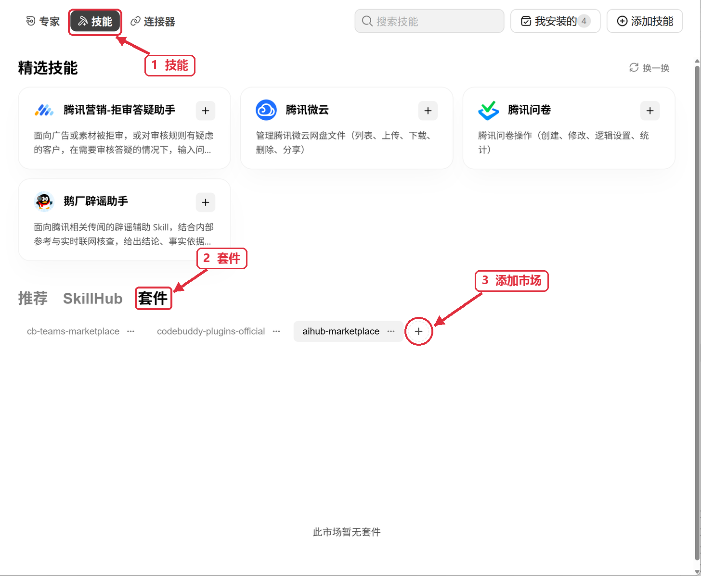

# AIhub Studio Plugin 4.0.0

4.0.0 从 `aihub-audio` 移除声音克隆，音频 Skill 现在提供文本转语音和语音识别／转写。旧 `audio-clone` 请求不再受支持；`voice-clone`、`minimax-voice-clone` 及其带提供方前缀或变体后缀的型号不能通过模型列表、`describe` 或 `generate` 发起克隆。使用旧模型列表的用户应移除这两个克隆型号。已有音色 ID 仍可用于语音合成。

4.0.0 将 TTS 默认设为 `eleven-v4`，异步音乐默认设为 `elevenlabs-music-v2.5`；ASR 继续使用 `paraformer-v2`，Gemini 原生音乐继续使用 `lyria-3-pro-preview`。静态文生图默认 GPT Image 2.6，图片编辑使用 2.5；两者均按速度优先 Flare、细节优先 Sunburst 选择。个人配置及本次明确指定的模型优先，已保存任务沿用原模型。

**ElevenLabs 音乐时长需要迁移。** 歌曲 `duration: 30` 改为 `music_length_ms: 30000`，段落 `duration: 15` 改为 `duration_ms: 15000`，全部为整数毫秒；旧字段明确拒绝，不自动换算。可告诉 Agent：“把这份 ElevenLabs 音乐请求迁移为整数毫秒，只预览计划，暂不提交。”已受理任务继续原 ID 查询与下载。custom-voice 使用已有音色 ID；Scribe V2/V3 可显式用于单 URL 或本地文件转写，保留词、说话人和时间戳字段。详见 [ElevenLabs](references/elevenlabs.md)。

Gateway v0.9.15 的官方／Fal 音频、Scribe 和 GPT Image 2.6 共 13 个生产任务已完成并对账；这属于服务端证据，不代替 Skill 宿主验收。音频已下载解码，人工试听仍待评审。2.6 当前只支持静态文生图，不接受参考图、遮罩、markup、GIF 或 SVG；实际尺寸、质量与格式以结果元数据及文件为准。requested_options_unavailable / unsupported_parameters 保留完整字段列表并停止自动切换，修改要求由用户决定。

本版已通过 Windows 原生 Codex 0.167.2 的开发源显式调用与离线计划，以及受影响回归和六个 Skill 的规范校验。本批按用户决定免测 Claude Code、WorkBuddy；macOS、重新安装与隐式发现待验。验收凭证可见 ElevenLabs 七款及 Paraformer，未返回 GPT Image 2.6；服务端生产证据与账号权限分别记录，实际运行仍须通过当前账号可见性检查。以下历史结果只对应其标明的版本。

遇到模型不可用时，可告诉 Agent：“只检查当前账号是否可见指定型号，保留原要求，不提交生成请求。”目录中有参数说明不代表当前 Key 已获得访问权限。

以下为历史 3.2.0 的功能与验收记录。

3.2.0 将视频唇形同步默认改为 `sync-3`，人像图片加音频数字人默认改为 `fabric-1.0`，图片、音频、视频和文件理解默认改为 `gemini-4-carbon`。本次明确指定的模型、已有模型列表配置及已开始任务继续优先使用原选择。

Fabric 未指定分辨率时使用 720p，也支持 480p；音频最多 30 秒，不接收动作提示词。Sync 3 不接收旧模型的表现力和活跃说话人参数。程序会说明不兼容条件，保留你的素材和要求。

2026-11-12，`gemini-4-carbon` 已通过正式 llm-custom 接口的图片、中文录音、短视频和 PDF 实测，四项均取得最终文本并核对内容。程序仍按当前账号的专用能力清单检查精确型号与输入能力；PDF 的实测结论不扩大到任意文件格式。

本批同时准备了 `eleven-v4`、`eleven-v4-turbo` 和 `elevenlabs-music-v2.5` 的接口适配。API 仍待试听验收及生产正式上线，TTS 默认暂为 `speech-2.8-hd`，异步音乐默认暂为 `lyria-3-pro`。上线确认后才启用已确定的新默认；显式模型和个人模型列表继续优先。详情见 [ElevenLabs 使用说明](references/elevenlabs.md)。

Windows 原生 Codex 已完成开发源显式调用的默认模型计划、ElevenLabs 计划/拒绝场景和 Carbon 四类真实输入验收；162 项本地回归通过。Sync 3 / Fabric 只确认账号可见性与本地参数流程，生成效果未复测。按本批决定，Claude Code、WorkBuddy 不做实测；macOS、重新安装和隐式触发待验。

理解结果的内容核对与自动检查状态分开显示：当前音频／视频原素材只有远端 URL 时，检查记录缺少绑定时长，可能保留 `inconclusive`；这不表示理解请求失败，也不能把它写成自动检查通过。可让 Agent 核对实际素材并说明覆盖范围。

以下为历史 3.1.0 的功能与验收记录。

3.1.0 在统一配置中心新增 MiniMax Speech 默认音色及音色库：搜索、筛选、试听预设样音，收藏候选并选择默认值。设置仅在任务没有指定音色时使用，已保存任务继续采用原参数。所有原 `/v1/` API 请求改走 `/e/v1/`；Gemini 原生音乐仍用 `/v1beta/`。

Windows 原生 Codex 0.167.1 已通过开发源显式调用、合成配置保存与回读及浏览器桌面 / 390×844 检查；真实只读音色接口返回 715 项，抽样试听通过。按本次用户要求，Claude Code、WorkBuddy 不做实测；macOS 待验。未重新安装 Plugin、验证隐式触发或执行付费合成。

以下为历史 3.0.1 的功能与验收记录。

3.0.1 修复首次保存被 Git 忽略检查拦住的问题：点击保存后自动准备所需保护，填写后即可保存，无需手动添加规则。配置项标题下新增实际字段名，便于对照文件；密钥值仍脱敏显示。

本版通过 Windows 回归、Codex 0.166.0 默认沙箱的正式配置入口保存与回读，以及两套浏览器页面和 390×844 布局检查。本次 WorkBuddy 按用户要求免验；macOS 待验，未重新安装或调用线上业务。

以下为历史 3.0.0 的功能与验收记录。

3.0.0 新增项目 `.env.local.aihub-studio`、`.env.aihub-studio`，六个 Skill 共用；依次优先于普通 `.env.local`、`.env`。

本版停止读取两种旧 Skill 后缀路径，保留 Skill 子目录及普通 Skill 全局回退。仅在退出位置保存过 Key 时，请按下方配置说明选择受支持位置；程序不会自动迁移。通过 Setup 委托配置时须使用 Setup AIHub 4.2.0 或更新版本，也可直接打开本 Plugin 自带配置页。

本批 Windows Codex 开发源显式加载、真实配置入口和页面 HTTP 闭环已通过，桌面与 390×844 浏览器检查通过；按用户对本批次的明确决定，WorkBuddy 免验；macOS 待验。本版未重新安装或验证原生发现、隐式触发及线上业务。

以下为历史 2.2.0 的功能与验收记录。

2.2.0 接入新版分层配置中心：查看当前生效值及逐项来源，辨认项目覆盖与全局继承，选择具体文件编辑，并在保存或移除覆盖前预览真实结果。一次只保存选中的文件，其他草稿继续保留。

本版已在 Windows 原生通过 Codex CLI 0.166.0 的开发源显式调用、两套随包服务启动、HTTP 配置预览/保存、原加载器回读和停止检查；独立浏览器完成桌面与 390×844 窄屏验证。71 项定向回归通过。按本次用户决定，WorkBuddy 不作为验收要求；macOS 待验。未替换现用 Plugin 安装，未验证原生重新安装、隐式触发、线上鉴权或付费业务。

以下为历史 2.1.1 的功能与验收记录。

2.1.1 修复 Markdown 产物的图片与富文本预览；共享入口缺少解析依赖时，会按锁文件恢复运行环境。

本版在 Windows 通过 Codex 0.166.0 的开发源显式调用、两套服务的启动/资源/下载检查，以及独立浏览器的图片显示与手机视口检查。原业务文档 29 张图片全部显示，真实文件保持不变。按本次用户决定，WorkBuddy 不要求实测；macOS 待验。未复测原生安装发现、隐式触发或线上业务；Codex 子会话自身的浏览器控制受限，独立浏览器结果另行记录。

以下为历史 2.1.0 的功能与验收记录。

2.1.0 新增 Hermes 原生入口，完整注册六个 Skill，继续使用共享业务脚本。默认规则与提醒识别当前 Hermes Profile；缺 Key 配置可交由 Setup AIHub 4.1.0 的 setup-api-key。

本版已通过 Windows 原生 Codex、WorkBuddy、Hermes 的入口加载与本机合成配置流程；Hermes 另验证 Profile 隔离及任务身份。未调用付费业务，未验证真实线上鉴权；macOS 本轮待验，Claude Code 保持兼容但未实测。历史结果仅覆盖所列版本。

以下为历史 2.0.0 的功能与验收记录。

2.0.0 自带配置中心与三种产物视图；新任务保存到 `data/aihub-studio/YYYYMMDDHHmmss-任务摘要-run-8hex/`，包含 `task-info.json`、会话/Agent 关联和最终文件。图片与视频显示封面，任务卡采用最多三个不同格式的预览。旧任务不索引或迁移。

2.0.0 Windows 原生已完成本地合成回归、正式页面桌面与手机视口检查，以及 Codex 0.166.0 / WorkBuddy 5.9.3 的原生安装、Skill 发现和代表性运行验收。macOS、真实鉴权与线上业务待验；Claude Code 兼容入口保留，本轮未实测。

以下历史记录只覆盖各自所列版本。

已发布的 **1.5.1**：默认设置采用“设为默认 (推荐)”，选择一次后直接设置并展示实际内容。Windows 默认规则测试 7 项通过；Codex 已在隔离测试文件中完成菜单、写入、恢复及完整内容展示。Claude Code 因额度 403 受阻，WorkBuddy 的输入与发送未能完成；本版原生安装及真实全局加载、macOS 仍待验，本次按用户明确指令发布，以上待验项继续保留。以下历史验收记录仅覆盖各自所列版本。

已发布的 1.5.0 在业务缺少 API Key 时打开 Setup 2.3.0 的本机配置网页，保存并复查后继续原任务；录音分段、全文合并及逐片恢复沿用现有能力。

1.5.0 在 macOS 通过 135 项回归及合成凭证网页保存、原加载器复查。Codex 0.166.0 已通过原生测试 Plugin 安装、业务缺 Key 触发、网页保存与跨轮恢复，默认沙箱保留，启动使用单次命令审批；Claude Code 2.1.317 成功加载完整 Plugin，实际调用被账号额度不足（403）阻断；WorkBuddy 原生窗口因辅助功能权限不可操作，本版会话流程未验证。Windows 原生、真实飞书授权与线上业务仍待验收。

让 Claude Code、Codex、WorkBuddy 或 Hermes 通过 AIhub 帮你生成和编辑图片、制作视频与音频、理解素材内容，或把 PDF 转成可编辑文档。适合已有 AIhub 调用账号、希望直接用对话描述任务的人。结果会保存到你指定的工作文件夹，Agent 会提供文件链接和实际检查结果。

## 默认使用与提醒

首次在一个会话中调用本 Plugin 的任意 Skill，Agent 会检查自己的全局及当前项目规则是否已明确优先使用对应的六个 Skill。已有等效规则时不询问；缺少时依次提供“设为默认 (推荐) / 本次跳过 / 不再提醒”，同一会话只提示一次，未答复仍继续当前任务。

选择“设为默认”后，Agent 直接写入当前 Agent 的全局规则，不再二次确认；完成并回读后，展示实际写入的[完整规则](references/default-skills-rule.md)、文件位置和影响范围。规则仅影响能力适用、且你未指定其他方案的任务，要求实际通过 AIHub 执行；网页或演示文稿中的图片生成等适用子任务也遵循此选择。AIHub 未安装、不可用、失败或能力不适用时，Agent 说明原因；使用其他执行通道需要你对本任务的明确授权，其他不受影响的子任务继续执行。普通对话、代码、搜索、图表、截图和通用 Office 创作不强行转交，辅助文件处理与按 Skill 流程进行的 Agent 结果检查仍可使用适用工具。相同规则文件被多个 Agent 共用时会在选择前说明；写入成功与新会话实际加载会分别报告。

已有旧版默认规则时，Agent 会说明它已覆盖的范围；你明确要求升级规则时直接更新，完成后展示内容和差异。

“不再提醒”只记录提醒选择，不设置默认，也不删除已有规则。你可以说：

> 不再提醒我把 aihub-studio 设为默认，只对当前 Agent 生效。

> 重新开启 aihub-studio 的默认使用提醒。

偏好自动读取并保存到运行用户的 `~/.config/aihub-studio/settings.json`，按 Agent 类型和实际配置目录分别记录；同一 Plugin 的六个 Skill 与后续版本共用，另一个 Plugin 独立。这个偏好不从环境变量或 `.env` 读取。文件缺失默认开启，检查不创建文件；只有你要求关闭或重新开启才保存。禁用本次全局配置会一起跳过提醒检查并禁止保存。检查不需要 API key、不联网；未知宿主或检查失败会说明情况并继续原任务。

本版提供 Codex、Claude Code、WorkBuddy、Hermes 的规则入口和提醒流程。Hermes 使用当前 Profile 的 SOUL.md；提醒选择按实际 HERMES_HOME 隔离。AIhub 既有业务运行支持范围不因这项检查扩大。macOS/Linux 按实际运行用户目录保存；Windows 原生使用 Node 运行时用户目录下的 `.config/aihub-studio/settings.json`，WSL 使用 Linux 用户目录，两者不自动共享。宿主真实会话加载须单独核验。

## 能做什么

| 你要完成的事 | 对应 Skill | 可以得到的结果 |
| --- | --- | --- |
| 按描述画图，或参考已有图片进行编辑 | `aihub-image` | 图片文件 |
| 按文字、首帧图片或参考素材生成视频；用音频驱动人像或同步视频唇形 | `aihub-video` | 视频文件 |
| 把文字读成语音、把录音转成文字 | `aihub-audio` | 语音文件，或转写文本及服务返回的时间戳等信息 |
| 按描述生成音乐 | `aihub-music` | 音乐文件 |
| 提问图片、音频、视频或文件中的内容 | `aihub-understanding` | 文字回答及文本文件 |
| 将 PDF 转为 Markdown、LaTeX 或 Word（DOCX） | `aihub-document` | 包含转换结果的 ZIP 压缩包 |

目前不提供图片增强、材质贴图、人物档案创建、视频高清放大、插帧、Sora 角色创建、仅凭文字生成数字人、字幕制作或纯文本聊天入口。视频的严格首尾帧控制、保留原片的编辑与续写、精确动作控制和转场尚未验证，不能保证达到这些效果。

你可以本次指定模型，也可以为每个 Skill 配置按顺序尝试的模型。没有模型配置时，静态文生图使用 GPT Image 2.6，编辑使用 2.5；常规任务选 Flare，明确细节优先且速度次要时选 Sunburst。视频按文字、明确首帧、参考素材选择对应的 Seedance 2.5 型号；人像与音频驱动使用 Fabric 1.0，视频唇形同步使用 Sync 3；素材理解使用 Gemini 4 Carbon，并检查当前账号的对应媒体能力。候选必须符合输入和输出要求，切换规则见下文。Flare 与 Sunburst 的速度和细节差异尚无严格对照实测，不能保证固定提升。

可以把这些话复制给 Agent：

> 用 eleven-v4 的 Rachel 朗读下面的文字，并保存原始时间戳：欢迎来到今天的节目。

> 用 elevenlabs-music-v2.5 创作 30 秒柔和钢琴纯音乐，保存音频。

> 检查上一次 ElevenLabs 任务并继续下载；使用原任务 ID。

ElevenLabs 音乐按实际输出整分钟向上取整计费；本轮 60 秒请求实际计 2 分钟，请求时长不能用来承诺最终费用。音频按实际文件格式保存，PCM 请求可能得到 WAV；语音时间戳里的空段会完整保留。

## 大录音转文字

可以直接说：

> 用 aihub-audio 完整转写这个录音。文件较大时按自然停顿处理，合并全文和全局时间戳，保留每段结果；中断后继续同一任务。

程序会上传音频并按片段调用 AIhub，消耗账号额度。满足所选模型与上传限制时整段处理，超限时分析实际波形，优先选较长停顿；没有合适停顿时在低能量处切分并保留短重叠。波形不能保证语义句末，重复内容会在边界去重，无法确定的部分会提示复核。

当前自动处理支持 Paraformer V2 及其 8 kHz 中文型号，其他候选缺少完整契约时明确说明。每个源最多 8 GiB，需要保存源快照及分片的磁盘空间。最终提供全文文本、含全局时间戳的结构化文件和逐段任务记录；服务未返回的时间戳不会补造，不把不同片段同号说话人视为同一人。查询或下载失败会继续原任务，提交不明时先核对远端状态。

完整原录音超过检查上传器限制时，Agent 会使用宿主能力检查并说明实际观察范围；抽听不代表全量检查。需要详细边界时，可让 Agent 参考[转写说明](references/audio-transcription.md)。

## 开始前准备

- **Agent：**本版提供 Claude Code、Codex、WorkBuddy 与 Hermes 的完整 Plugin 入口；各宿主的实际验证范围见下文。
- **账号：**只需配置 `AIHUB_API_KEY`（调用服务的密钥），服务地址固定为 `https://api.aihubmax.com`。模型访问权限和额度由账号决定。
- **运行工具：**添加插件市场需要 Git；运行任务需要 Node.js 18 或更新版本，以及 FFmpeg 中的 `ffprobe`；录音转写还需要 `ffmpeg` 分析与处理音频。可以让 Agent 检查并指导安装；Plugin 本身不会自动安装系统工具或本机模型，也不需要另行启动 MCP 服务。
- **Windows 文件保护：**保存私有任务、诊断或检查记录时需要系统自带的 Windows PowerShell 5.1 和支持访问权限的文件系统。程序在写入内容前限制为当前用户与 SYSTEM 可访问；无法设置或回读权限时停止保存并报告原因。只读配置检查不要求 FFmpeg 或这一步保存能力。
- **输入素材：**把文件放在 Agent 能访问的位置，或提供服务能访问的链接。录音转写可直接提供大文件，程序会按模型及上传限制自动处理；其他任务的本地上传仍限 20 MiB，更大素材使用模型支持的远程链接。

**历史 1.2.0 验证范围：**Windows 原生已通过三宿主完整 Plugin 安装与 Skill 发现；Codex 默认沙箱及 WorkBuddy 已通过凭证缺项转交、手填、恢复与最小回退，Claude Code 已通过自然请求触发，配置闭环未实测。Secret Book 2.5.2 真实表配置、恢复与清理已通过。这些结果只覆盖配置能力，不代表新的 `setup-api-key` 转交已完成宿主验收。历史版本在 macOS 上直接运行共用程序，已完成部分图片生成、语音、转写、音乐、图片理解和 PDF 转换请求；Seedance 2.5、音画同步与数字人、Gemini 原生音乐，以及三宿主中的完整媒体业务仍需各自验收。Linux、WSL 与本版 macOS 流程尚未验证。

## 让 Agent 帮你安装

AIhub 通过 CNB 与 GitHub 来源分发。请按当前使用的 Agent 选择对应的安装说明。

### Claude Code：通过原生 Plugin 管理安装

复制下面这段话到 Claude Code：

```text
请在 Claude Code 中安装完整的 AIhub Studio Plugin（aihub-studio@aihub-marketplace）：优先用 https://cnb.cool/zhidateam/tannt/aihub-marketplace.git，CNB 网络故障时改用 https://github.com/cookaihq/aihub-marketplace.git，保持同一 Plugin 和版本。先阅读仓库 README 和 aihub-studio/README.md，使用 Claude Code 的原生 Plugin 与 Marketplace 管理入口添加或复用 aihub-marketplace，再安装 aihub-studio，保留已有设置。分别报告市场添加、Plugin 安装、Skill 发现与调用的结果；如需新会话，请指导我操作。
```

### Codex：通过原生 Plugin 管理安装

复制下面这段话到 Codex：

```text
请在 Codex 中安装完整的 AIhub Studio Plugin（aihub-studio@aihub-marketplace）：优先用 https://cnb.cool/zhidateam/tannt/aihub-marketplace.git，CNB 网络故障时改用 https://github.com/cookaihq/aihub-marketplace.git，保持同一 Plugin 和版本。先阅读仓库 README 和 aihub-studio/README.md，使用 Codex 的原生插件管理入口添加或复用 aihub-marketplace，再安装 aihub-studio，保留已有设置。分别报告市场添加、Plugin 安装、Skill 发现与调用的结果；如需新会话，请指导我操作。
```

### Hermes：通过原生 Plugin 管理安装

> 请在当前 Hermes Profile 安装完整 aihub-studio Plugin。先读仓库及 aihub-studio 的 README，通过 Hermes 原生安装入口使用 https://github.com/cookaihq/aihub-marketplace.git#aihub-studio；网络故障时换为 https://cnb.cool/zhidateam/tannt/aihub-marketplace.git#aihub-studio 的同一版本。保留已有设置和本地修改，启用后核对六个 Skill。显式加载 aihub-studio:aihub-image，运行本机配置检查，分别报告发现、执行与业务请求结果。缺 Key 时使用完整 Setup AIHub 4.1.0 或更新版，不单独复制 Skill 文件。

固定版本时，让 Agent 将已发布的 `aihub-studio/v2.1.0` tag 解析为完整 40 位提交 SHA，再传给安装器的 `--ref`；不能直接传 tag 名。未固定版本的安装可先检查 `hermes plugins check-updates`，你要求更新后由原生 `hermes plugins update aihub-studio` 更新完整包。固定版本不会随普通更新移动；更换版本时确认新提交，再由原生安装器使用同一来源、`--force --ref` 替换。当前 Profile 的安装、显式加载与自然请求选择分别核对；[Profile 与默认规则](references/default-skills.md#hermes-入口与-profile)说明实际目录。业务配置仍使用原有 `.config/aihub-studio/`，不会自动搬入 Profile。

### WorkBuddy：通过原生套件管理安装

复制下面这段话到 WorkBuddy：

```text
请在 WorkBuddy 中安装 AIhub Studio Plugin：优先用 https://cnb.cool/zhidateam/tannt/aihub-marketplace.git，CNB 网络故障时改用 https://github.com/cookaihq/aihub-marketplace.git，保持同一 Plugin 和版本。先阅读 aihub-studio/README.md 和 aihub-studio/references/workbuddy-install.md，使用当前应用的原生套件管理，不另起 CodeBuddy CLI。需要我操作界面时，请在回复中展示随包的添加市场截图，并指明“技能 → 套件 → 市场名称右侧的＋”。安装完整的 aihub-studio@aihub-marketplace，保留已有设置，并确认 Skill 可发现和调用。
```

WorkBuddy 使用 **专家·技能·连接器 → 顶部“技能” → “套件” → 市场名称一行最右侧的圆形“＋”**；点击后才会出现“添加市场”窗口。下图来自 Windows WorkBuddy 5.6.2 的实机截图，macOS 5.6.2 的入口也已核对；图中的“此市场暂无套件”仅记录截图时的本机状态，不代表完整安装或 Skill 调用已验收。具体步骤见 [WorkBuddy 安装说明](references/workbuddy-install.md)。Agent 有界面操作能力时可代为完成，需要你操作时会同时展示截图和步骤。安装过程沿用 WorkBuddy 已有配置，不应为此新建 `.codebuddy`；无需手动执行终端命令。



“套件”在“SkillHub”右侧；添加市场使用市场名称右侧的“＋”。

## 从旧 AIhub Plugin 迁移

1.0.0 将安装对象从 `aihub@plugin-marketplace` 改为 **`aihub-studio@aihub-marketplace`**。新市场与旧市场是两个独立安装来源；只更新旧市场中的 `aihub` 不会换成新名称。先核对并准备下文的新配置，再按上面当前 Agent 对应的安装说明安装 AIhub Studio；随后停用旧 `aihub`，打开新会话，核对实际加载的 Plugin 身份、版本与六个 Skill 的来源，再验证调用。确认新版本可用后才卸载旧对象，不自动删除其配置。保留旧市场中的其他 Plugin；不能在两份同名 Skill 都启用时，把调用成功认定为新版通过。

该次迁移保留六个 `aihub-*` Skill 名、`AIHUB_*` 配置字段与既有任务记录；3.0.0 的配置来源变化见下文。**Plugin 个人全局配置目录由 `~/.config/aihub/` 改为 `~/.config/aihub-studio/`；新版本不自动读取或搬迁旧 Plugin 目录。** 如果密钥只保存在旧目录，需要确认迁移或重新配置后才能使用新版本。当前 Skill 的 `~/.config/aihub-image/.env` 等普通 Skill 文件仍可作为末层来源。

需要迁移旧 Plugin 配置时，可以说：

> 请把旧 AIhub Plugin 的配置迁到 AIhub Studio：先只报告 `~/.config/aihub/` 中实际使用的共享文件、当前 Skill 专用文件和来源，将共享文件与 Skill 子目录映射到 `~/.config/aihub-studio/`；旧根目录的 Skill 后缀文件另行选择受支持的 Skill 子目录目标。核对新位置和环境变量、项目配置是否已有覆盖，列出将新增或替换的文件和字段，隐藏密钥，等我确认后再保存。保留旧文件，不合并不同账号；写完只检查本机配置来源，不提交业务请求。

共享 `.env`、`.env.local` 及 `<skill-name>/.env.local`、`<skill-name>/.env` 可保留相对位置；旧根 `.env.<skill-name>` 须单独确认新的 Skill 子目录目标及覆盖关系，不扫描备份文件，也不把各 Skill 的不同配置任选一份合并到共享文件。Windows 原生与 WSL 仍分别使用各自用户目录，不跨环境复制。安装、配置迁移和真实业务验证分别报告，旧目录在迁移确认前保持原状。

## 完成首次配置

业务缺少 API Key 时，Agent 会打开本 Plugin 自带的配置中心；已有配置可以直接使用。你也可以说：

> 打开 AIhub Studio 的配置页面。我会在网页填写 API Key，保存后请检查本机配置，再继续原任务。

页面先展示当前生效配置，逐项标出项目覆盖、继承全局或其他来源。点击“编辑”可选择保存范围和具体文件，在保存或移除设置前预览实际生效值及来源；“来源与优先级”显示该项真实的读取顺序。Key 输入框下有 [AIhub 控制台](https://api.aihubmax.com/console) 获取链接，也可联系团队负责人分配。模型顺序、结果检查和提醒偏好可在同页调整，服务地址无需展示或填写。

首次新增默认个人全局 `~/.config/aihub-studio/.env`；新增项目密钥默认使用 `.env.local.aihub-studio`，也可明确选择普通 `.env.local`，已有密钥可选择原文件修复或移除。每次只保存所选文件，其他文件的草稿继续保留；保存较低优先级的文件时，预览会说明是否仍被上层覆盖。页面不会自动保存草稿，完整 Key 不进入聊天或进度记录。保存时校验本机配置，不验证在线鉴权；主动打开音色库会用音频配置读取线上列表。已有 Setup 配置任务仍可从原编号继续，打开同一配置中心。

### 选择默认音色

> 请打开完整 AIhub Studio 配置中心，我想为 MiniMax Speech 选择默认音色。让我搜索和试听预设音色、收藏候选，再保存选中的默认音色。

音色库可以按名称、ID、语种和描述搜索，并按语种、性别、风格筛选。点击播放只试听已有样音；点击星标暂存收藏，顶部出现“保存收藏”后可单独保存。“使用此音色”回填原编辑面板，仍需明确保存才成为默认值。关闭弹窗保留收藏草稿。自定义音色也可手填 ID。

默认值仅用于 Speech 2.8 HD / Turbo 未指定音色的新任务；本次明确指定的音色优先，已开始任务不受后来修改影响。收藏是个人候选列表，不会自动轮换或改变默认值。详细配置与来源见[MiniMax Speech 默认音色](references/model-selection.md#minimax-speech-默认音色)。

配置页面只供同机浏览器访问，闲置 60 分钟结束。**📱 手机或其他设备访问需要 FRP / Tailscale；让 Agent 先核对实际配置状态。** 明确选择文件编辑或没有浏览器时，Agent 可说明完整本机路径供本人填写，详见[配置衔接](references/credential-setup.md)。

保存后通过真实业务加载器复查；本机读取成功不代表线上鉴权或生成成功。未提交且原授权有效才继续，已提交或结果不明先查询原结果。业务配置不再提供 Secret Book 方式，受支持的本机文件按下表读取；3.0.0 退出的来源不会自动迁移。

### 从 2.x 升级的配置变化

3.0.0 新增项目 `.env.local.aihub-studio` 和 `.env.aihub-studio`，六个 Skill 共用。项目 `.env.<skill-name>` 与全局 `~/.config/aihub-studio/.env.<skill-name>` 不再读取；若 Key 只在这两处，升级后需要重新配置。Skill 子目录的 `.env.local/.env`、普通 Skill 的 `~/.config/<skill-name>/.env` 和普通项目 `.env.local/.env` 仍保留。

可对 Agent 说：“检查本次升级的配置来源，隐藏密钥，列出旧位置及受支持目标，等我确认后再迁移，保留原文件。”共享项目配置可选择 `.env.local.aihub-studio`，独立全局配置可选择 Skill 子目录；程序和安装过程都不会自动迁移。普通 `.env.aihub-studio` 可编辑非密钥设置和修复已有密钥；新增项目密钥使用上述本地文件，写前须被 Git 忽略且未跟踪。

### 配置保存在哪里，先读取哪一份？

修复按每个字段的实际来源确定原文件；来源为进程环境变量时，在原注入位置修复，页面只读展示其状态。

下面以图片 Skill `aihub-image` 为例，越靠前越优先。视频、音频、音乐、素材理解和文档分别将全局 Skill 子目录名和普通 Skill 回退目录名中的 `aihub-image` 换成 `aihub-video`、`aihub-audio`、`aihub-music`、`aihub-understanding`、`aihub-document`；Plugin 目录始终叫 `aihub-studio`。

| 顺序 | 位置 | 作用 |
| --- | --- | --- |
| 1 | 运行程序时的环境变量 | 当前进程已有或本次传入的设置 |
| 2 | 工作文件夹的 `.env.local.aihub-studio` | 当前项目内六个 Skill 共用的本地优先配置 |
| 3 | 工作文件夹的 `.env.aihub-studio` | 当前项目内六个 Skill 共用 |
| 4 | 工作文件夹的 `.env.local` | 当前项目内读取同名字段的 Skill 共用 |
| 5 | 工作文件夹的 `.env` | 当前项目的补充配置 |
| 6 | `~/.config/aihub-studio/aihub-image/.env.local` | 图片 Skill 子目录中的优先覆盖 |
| 7 | `~/.config/aihub-studio/aihub-image/.env` | 图片 Skill 子目录中的配置 |
| 8 | `~/.config/aihub-studio/.env.local` | 六个 Skill 共用的优先覆盖 |
| 9 | `~/.config/aihub-studio/.env` | 首次新增配置的默认保存位置，六个 Skill 共用 |
| 10 | `~/.config/aihub-image/.env` | 普通图片 Skill 的配置，仅补齐前面各层缺失或为空的项 |

只需要图片 Skill 使用不同全局设置时，可让 Agent 协助使用 `~/.config/aihub-studio/aihub-image/.env`；需要更高优先级时使用该子目录的 `.env.local`。无需预先创建六个子目录或复制相同密钥。每次只读取当前 Skill 的专用文件、Plugin 共享文件和当前 Skill 的普通全局 `.env`，不读取普通 Skill 目录的 `.env.local`，也不扫描其他 Skill、旧产品别名目录或 `.env.backup` 等文件。

**密钥及业务选项按字段取首个非空值。** 子目录不存在、目录为空、文件缺失或某项为空时，继续向下查找；Plugin 目录存在或已填好一项，也不阻止其他缺项读取第 10 层。文件存在但无法读取时会报错，所有来源都没有密钥就提示配置。服务地址始终固定，环境变量或文件中的旧 `AIHUB_BASE_URL` 被忽略，原文件保持不变。

“工作文件夹”是 **Agent 实际执行任务的文件夹**，不是 Plugin 安装目录。程序不向父文件夹搜索项目配置。个人全局配置自动读取，但环境变量和当前工作文件夹中的配置仍优先；全局文件不随工作文件夹切换而改变。

没有具体业务 Skill 时，配置检查可只查看工作文件夹的 `.env.local.aihub-studio`、`.env.aihub-studio`、`.env.local`、`.env` 与 Plugin 共享全局 `.env.local/.env`，不假借某个 Skill 或读取其专用层。这不代表六个 Skill 已全部验证。清除选定字段前可以只读预览清除后是否回退到其他来源；不会为预览临时修改文件。本机凭证检查无需 ffprobe，也不发线上鉴权请求。

| 实际运行环境 | Plugin 共用全局配置文件 | 普通 Skill 回退文件，以图片为例 |
| --- | --- | --- |
| macOS / Linux | `~/.config/aihub-studio/.env`，`~` 表示运行程序的用户个人文件夹 | `~/.config/aihub-image/.env` |
| Windows 原生环境 | `%USERPROFILE%\.config\aihub-studio\.env`，通常如 `C:\Users\你的用户名\.config\aihub-studio\.env` | `%USERPROFILE%\.config\aihub-image\.env` |
| WSL（Windows 上的 Linux 环境） | WSL 用户的 `~/.config/aihub-studio/.env`，通常如 `/home/你的Linux用户名/.config/aihub-studio/.env` | WSL 用户的 `~/.config/aihub-image/.env` |

表中的 `aihub-studio/` 内也可以保存 `.env.local` 及当前 Skill 的可选子目录。个人文件夹由实际运行程序的环境决定：macOS、Linux 和 WSL 优先使用 `HOME`，Windows 原生环境优先使用 `USERPROFILE`；未设置时使用系统提供的当前用户目录。WSL 不会自动读取 Windows 用户配置。可让 Agent 确认完整路径；**路径说明不代表对应平台已完成兼容性验证。**

两类全局目录默认都会读取。若某次任务只应使用环境变量和项目配置，可以说：

> 这次 AIhub 任务请关闭个人全局配置读取，同时跳过 Plugin 目录和普通 Skill 目录，只使用环境变量和当前工作文件夹中的配置，并报告实际来源。不要修改配置文件。

也可以明确要求 Agent 将新配置仅保存到项目的 `.env.local.aihub-studio`（也可明确选择普通 `.env.local`）；位于 Git 项目内时，写入密钥前须确认该文件未被跟踪且已被忽略。仅选择项目保存不会自动关闭全局读取，需要时使用上面的请求。

已有的 `~/.config/aihub-image/.env` 等当前 Skill 配置无需迁移，即可作为末层来源。同一用户下，同名 Skill 的独立安装和 Plugin 安装可能共用该文件，Plugin 中的非空值始终优先。默认保存位置仍是 `~/.config/aihub-studio/.env`，程序不会创建、复制或搬迁已有配置。若希望主动整理这些文件，可以说：

> 请检查我以前按 Skill 保存的 AIhub 配置，隐藏密钥，列出准确的源路径和目标路径，等我确认后再迁移。相同配置可放入 AIhub Studio Plugin 的共用文件，不同账号保留为各 Skill 的专用配置，保留已有文件，不自行覆盖。迁移是可选操作。

配置未生效时可以说：

> 请检查这次 AIhub 任务的实际工作文件夹，密钥来自哪个文件或环境变量，是否被更高优先级设置覆盖，并确认程序使用固定 AIhub 服务地址。只报告来源和是否已填写，不显示密钥，也不修改文件。

## 可选：模型顺序和失败切换

只填写 Key 就能使用各任务的内置型号。需要多个候选时，在已选择的配置文件中添加相应项，例如：

```dotenv
AIHUB_IMAGE_MODELS=gpt-image-2.5-flare,gpt-image-2.5-sunburst
AIHUB_MODEL_FALLBACK_POLICY=auto
AIHUB_MODEL_MAX_ATTEMPTS=2
```

| Skill | 模型列表配置名 |
| --- | --- |
| 图片 | `AIHUB_IMAGE_MODELS` |
| 视频与数字人 | `AIHUB_VIDEO_MODELS` |
| 音频与语音 | `AIHUB_AUDIO_MODELS` |
| 音乐 | `AIHUB_MUSIC_MODELS` |
| 素材理解 | `AIHUB_UNDERSTANDING_MODELS` |
| 文档转换 | `AIHUB_DOCUMENT_MODELS` |

列表使用逗号分隔的精确型号，按顺序尝试；高优先级文件中的列表整体替换后面的列表。未配置时只选一个内置型号，不自动添加备用。本次对话明确指定型号时只用该型号，不再 fallback。

`AIHUB_MODEL_FALLBACK_POLICY` 有四种取值，均为可选：

| 值 | 行为 |
| --- | --- |
| `auto`（默认） | 在已配置且满足原要求的候选间自动尝试。 |
| `confirm` | 每次换模型前展示下一模型和参数，等你确认。 |
| `off` | 只尝试任务用途匹配的首个候选。 |
| `preflight_only` | 只允许在尚未提交生成前，跳过不可见或不兼容候选；提交后失败就停止。 |

`AIHUB_MODEL_MAX_ATTEMPTS` 可限制本次任务最多尝试几个模型，包括首选；默认最多尝试适用候选各一次。预检跳过、查询进度和下载不占次数。模型切换可能产生新的 API 费用。

配置型号后仍需已有参数转换支持：程序对每个候选分别检查，不会省略参考素材或降低指定时长、分辨率、音色等要求。例如 20 秒视频不能切换到最多支持 15 秒的型号。当前已接入的转换范围见 [模型与任务说明](references/model-selection.md#任务-json)。

自动切换只处理可确认的模型不可用或能力失败。提交结果不明、仍在运行、鉴权/额度/内容拒绝、未知服务错误、查询或下载失败都不会直接产生替换任务。内容不符合要求也不等于可以自动重做。继续任务使用已保存的列表和策略；修改配置不会改变已开始的任务。

## 默认开启的结果检查

生成完成后，Agent 会检查实际结果是否符合你的原始需求，给出“符合、不符合、证据不足或无法检查”的结论。文件能打开并不代表内容符合；视频只看过部分帧、没有检查音轨等情况会明确说明。检查失败或内容不符会保留并交付已有文件，由你决定是否修改或重做。

默认先使用当前 Agent 能用的图片、音频、视频或文档工具。缺少必要能力时通过 AIhub 检查，默认检查模型为 `gemini-3.8-flash`；会把结果、需求与必要原素材发送给 AIhub，并额外消耗额度。当前账号没有该模型或所需能力时，会报告无法检查。Jev 不属于本版依赖。

**每次完成检查后，Agent 都会提醒你可以通过对话关闭。** 可以说“仅本次关闭结果检查”“以后关闭 AIhub 的结果检查”或“恢复结果检查”。Agent 会按你明确的范围执行；范围不明时会询问。关闭后仍检查文件格式与能否解析。

以下配置均可省略：

```dotenv
AIHUB_RESULT_CHECK_ENABLED=1
AIHUB_RESULT_CHECK_PROVIDER=auto
AIHUB_RESULT_CHECK_MODELS=gemini-3.8-flash
```

开关只接受 `1` 或 `0`。provider 可为 `auto`（上述默认流程）、`host`（只用 Agent 自身能力）或 `aihub`（直接使用 AIhub）。模型可配置逗号分隔的有序列表，程序在提交前选择首个可见且能力匹配的型号；检查失败后不会自动再调用第二个型号。明确要求重新检查时才会提交新检查请求。

AIhub 检查需要上传实际产物，单个产物沿用 20 MiB 限制，超过时需宿主直接检查。文档正文提取不能证明排版、嵌入图片或公式完全保真，Agent 会说明实际检查范围。操作和限制详见 [结果检查说明](references/result-checks.md)。

## 请求出错后的本地报告

第一次接口请求失败、无效响应或远端任务执行失败时，就会在任务文件夹保存一份可阅读的 `error-report.md`。报告包含用户原始需求、实际提示词与参数、脱敏请求/响应、可观察的 HTTP 状态、任务状态、耗时和已有重试、模型切换情况。后续错误更新同一份文件；反复查询同一个失败任务不会增加错误次数。

每次失败反馈、继续查询、恢复成功及最终总结都会提供完整绝对路径的可点击链接，包括 Markdown 报告、`diagnostic.json`、`issue-draft.md` 和已有请求上下文。你可以说：

> 打开这次任务的本地错误汇总，解释实际请求、失败阶段和仍未知的信息。继续查询已有任务，不要重新提交。

HTTP 状态是客户端实际收到的 AIHub 响应，不代表供应商 HTTP 状态。远端任务可以在 HTTP 200 中报告失败；`service_unavailable` 本身不能证明上游宕机。服务没有返回的上游状态、路由和内部重试会标为未知，可让管理员按本地任务/请求 ID 查后台日志。旧诊断中固定填写的终止失败 HTTP 200 会标记为未经采集的历史值。

本地报告含私密提示词与素材定位信息，仅保存在本机；API Key、Authorization、Cookie 和链接签名会脱敏，二进制或超长内容明确标注省略。公开 Issue 草稿继续排除原始需求、素材链接和定位 ID。程序不会自动发送报告或创建 Issue，也不会为报告重发请求或改变模型切换策略。保存失败时保留原任务结果，并说明报告未完整保存。

`AIHUB_ERROR_REPORT_THRESHOLD` 保留旧配置兼容，不再延迟首次报告和提醒；`AIHUB_SUPPORT_URL` 保留服务支持入口。详细说明见[本地错误报告](references/error-reports.md)。

## 第一次使用

安装和配置完成后，选择用于保存素材和结果的工作文件夹，然后继续与 Agent 对话。**下面的请求会把描述发送到 AIhub，可能消耗账号额度或产生费用，并将结果下载到本机。** 涉及参考素材的任务还会上传文件或把素材链接发送给服务，供服务处理；只提供你允许用于这次任务的内容。

```text
用 aihub-image 生成一张正方形插画：一只戴红围巾的橘猫坐在窗边，
画面简洁，不添加文字。这次做常规草稿，速度优先。
把结果保存在当前工作文件夹的 data/aihub-studio/ 中，完成后给我图片文件链接，
并说明实际做了哪些文件和画面检查。
```

成功时会得到可打开的图片文件、完整路径、实际使用型号和检查说明。新任务默认保存在 `data/aihub-studio/20261106143025-任务摘要-run-a1b2c3d4/`，`run.json` 记录需求、候选和尝试过程；每个异步尝试保留自己的 `task.json`，最终成果集中在最外层任务的 `files/`；`task-info.json` 保存任务与可靠会话、Agent 关联。输出位置可以改成你需要的文件夹。

只有任务编号、进度或远程链接，还不算图片已交付。若仍在生成或下载失败，Agent 应保留原任务记录，说明当前状态并继续查询同一任务。交付文件时同时给出上述结果检查结论；检查尚未完成时说明进度，继续同一检查任务。

## 浏览产物

Markdown 详情现在显示标题、强调、列表、表格和文档同目录或子目录内的 PNG、JPEG、GIF、WebP 附图，支持中文和空格路径。缺图或不允许的引用显示原因；远程图片、越界路径和 SVG 不加载。复制与下载保留原始 Markdown，附图不增加产物数量。

> 打开当前项目的 AIhub Studio 产物页面。

默认“按任务”展示文件夹，点击后查看本次任务的文件，再进入详情。“按会话”在桌面左边选会话、右边看任务；“按文件”平铺所有成果。任务卡片最多横排显示 3 个不同格式的缩略图，图片和视频展示封面。顶部显示当前项目真实 Git 分支，手机支持逐层进入和返回。

新任务目录示例为 `data/aihub-studio/20261106143025-抖音评论分析-run-a1b2c3d4/`。程序保留创建者，并追加实际参与会话和 Agent；没有可靠身份的任务显示为“未关联会话”。Agent 整理的最终报告默认 Markdown，表格和数据保留 CSV/JSON，保存并登记后进入页面。失败、部分完成及零成果任务也可见，诊断和转写分片不计成果数。

本次页面只读取新规范任务，旧 `data/aihub/` 不扫描、不搬移、不补记录。整项任务放在其他目录时，由 Agent 显式指定该任务根。文件缺失或变更会保留记录并提示；页面不执行重试、删除或业务请求。

产物与配置页面独立，默认闲置 60 分钟结束；产物可选择本次常驻，停止后不影响已保存文件。**📱 跨设备访问需要 FRP / Tailscale，实际配置状态由 Agent 核对。**

## 常用请求

下面的任务同样可能发送素材并计费。把示例中的文件名换成你自己的文件名，并告诉 Agent 文件所在位置；也可以在支持附件的对话中提供文件，再让 Agent 确认是否能够读取。

| 对 Agent 说什么 | 预期结果 |
| --- | --- |
| 用 aihub-image 编辑我提供的 product.png，把背景改成浅灰色，尽量保留产品外观；细节优先，不赶时间。 | 编辑后的图片；精确像素尺寸和遮罩外逐像素不变尚未验证 |
| 用 aihub-video 把我提供的 landscape.png 作为首帧，生成 5 秒、720p 的视频，让镜头缓慢向前移动。 | 视频文件及实际检查说明；Seedance 2.5 的真实生成效果尚未完成验证 |
| 用 aihub-audio 把“欢迎收听今天的节目”读成中文语音，使用 speech-2.8-hd，保存音频并告诉我文件位置。 | 语音文件和文件检查结果 |
| 用 aihub-audio 把我提供的 interview.mp3 转成文字，保留服务返回的时间戳，并给我结果文件。 | 转写文字和保存结构化结果的 JSON 文件；是否含时间戳以服务返回内容为准 |
| 用 aihub-music 生成一段轻快的钢琴背景音乐，使用 lyria-3-pro，保存到当前项目并给我音频链接。 | 音乐文件；可播放性检查与实际试听结果分别说明 |
| 用 aihub-understanding 描述我提供的 photo.jpg 中有哪些物体及其位置，并把回答保存为文本文件。 | 文字回答和文本文件路径 |
| 用 aihub-document 把我提供的 report.pdf 转成 Markdown，返回转换结果包；请先读取 PDF 确认页数，无法确定时再问我。 | ZIP 文档包；程序检查包的非空与 ZIP 文件签名，不保证包内文档内容完整 |

## 任务中断和结果保存

新任务先保存 `run.json`，每次异步提交另存 `task.json`，拿到任务编号后继续写入。需要继续时，把上次返回的记录路径发给 Agent：

> 用上次的 AIhub Skill 继续这个任务：〈run.json 的完整路径〉。请核对原服务和密钥，按已保存的模型列表和切换策略继续，保留已成功的文件；提交结果不明时先停止核对。

路径来自上次任务结果，不需要自己编写记录。旧 `task.json` 和只有任务编号的任务仍可查询、下载原结果，不触发新生成。按记录恢复会核对原 Skill、服务地址和密钥，密钥换过后不能直接沿用旧记录。其他服务地址创建的旧任务会在联网前拒绝恢复，保留记录并提示使用原服务客户端继续；官方固定地址的旧任务仍可恢复。新 `run.json` 的继续流程在确认模型失败后，可能按保存策略提交下一候选。

- **等待结束不等于生成失败。** 可以继续查询同一任务。下载或文件检查失败，也应先恢复原任务；部分成功时先取得已通过检查的文件。
- **提交结果不明时不能保证自动恢复。** 若服务尚未返回任务编号，记录只能保存这次的不确定状态，无法据此找回远端任务。先核对原请求结果，不能把重新生成当作恢复，也不能假定不会计费。
- **Gemini 原生音乐没有可查询的任务编号。** 新流程会保存 run 和返回音频，但提交结果不明时不能据此找回远端结果或自动重发；直接原生命令也保存任务基本信息和结果记录。`lyria-3-pro` 则使用普通异步任务流程。
- **记录和结果由你保留。** 程序不会自动清理任务文件夹。删除记录会失去该记录提供的恢复入口；记录可能包含任务内容和素材链接，分享前请检查。文件不会写入 Plugin 安装目录。

文件交付阶段检查非空、类型及能否解析，PDF 包检查 ZIP 签名。开启结果检查后，另读实际媒体或转换正文，并按原素材核对。`review.json` 保存检查结论与证据；继续任务会复用已完成的检查。它不等于完整播放、逐帧检查或内容审核，实际覆盖范围以报告为准。

## 遇到问题时，可以这样问

| 遇到的问题 | 发给 Agent 的话 |
| --- | --- |
| 插件市场找不到 AIhub，或安装后找不到 Skill | 请先确认使用的是 GitHub 还是 CNB，核对该来源是否已发布 aihub-studio、是否安装到当前 Agent、六个 Skill 是否完整，以及是否需要新会话；区分尚未发布或同步与本机安装问题。 |
| WorkBuddy 找不到“添加市场”按钮 | 请在回复中展示随包的添加市场截图，指明“技能 → 套件 → 市场名称右侧的＋”；“添加市场”是点击后的窗口标题。界面不同时先核对当前页面和版本。 |
| WorkBuddy 查询到空插件列表，或出现新的 `.codebuddy` 目录 | 停止另起 CodeBuddy CLI，按随包的 WorkBuddy 安装说明从原生套件管理查看市场和安装结果；保留已有目录及配置。仅补配置目录环境变量不能阻止旧版 CLI 创建诊断目录。 |
| 想用 CNB，但已添加 GitHub 的同名插件市场 | 请检查 aihub-marketplace 当前来源，说明切换到 CNB 的方式及对已安装插件的影响，保留我的插件和设置。 |
| 提示缺少 Node.js 或 ffprobe | 请检查当前运行环境中这两个工具是否能执行，并给出适合我的系统的安装或修复步骤。 |
| 缺少密钥，或修改配置后未生效 | 请报告缺失或错误字段的实际来源和依据，打开本 Plugin 配置中心供我修复；已有明确选择则沿用，修复原文件并重新检查，隐藏密钥值。 |
| 密钥被拒绝或查不到模型 | 请核对 AIhub 密钥的实际来源，区分认证被拒绝、网络异常、额度和权限问题。需要修复配置时打开本 Plugin 配置中心，修复后先验证，不自动重发原任务。 |
| 模型列表能看到，但生成失败 | 请说明服务返回的原因和任务是否已创建；模型可见不代表当前生成通道或额度可用。 |
| 只有任务编号，或等待、下载失败 | 请用已有记录或任务编号查询同一任务，列出已完成文件和仍未完成的部分，不重新生成。 |
| 提示提交结果不明 | 请保留当前记录，说明有没有任务编号，以及还能怎样核对原请求结果；先不要再次提交。 |
| 文件已下载，但不确定结果是否正确 | 请说明已经做过哪些文件检查，再根据可用的查看或试听能力检查内容，列出无法验证的部分。 |

## 更新

AIhub Studio 按完整 Plugin 更新，六个 Skill 会一起更新。更新对象是 `aihub-studio@aihub-marketplace`；从旧 `aihub@plugin-marketplace` 切换时按上面的迁移步骤操作。更新通过你当前使用的 Agent 的插件管理功能进行，读取当前已配置的 GitHub 或 CNB 来源；WorkBuddy 的查询和更新继续遵循 [WorkBuddy 安装说明](references/workbuddy-install.md)，沿用同一宿主配置目录。从 CNB 安装时，需要该版本已同步到 CNB 才能取得。本 Plugin 不带独立 Skill 的自动检查更新脚本，也不读取 `AUTO_UPDATE_CHECK` 开关。是否自动更新取决于宿主提供的功能和设置。

想了解新版时可以说：

> 请通过当前 Agent 的插件管理功能检查 AIhub 的已安装版本和当前来源的可用版本，告诉我来源是 GitHub 还是 CNB，并结合更新记录说明变更内容。这次只检查。

决定更新后可以说：

> 请把完整 AIhub Studio Plugin 更新到当前可用版本，保留我的个人全局配置、项目配置、任务记录和结果文件。完成后检查六个 Skill 能否发现和调用；如需新会话，请指导我操作。

检查更新与提交生成请求是两件事，不需要为检查更新生成图片或其他素材。版本变更见随包的 [更新记录](CHANGELOG.md)；需要进一步诊断时，可让 Agent 参考 [配置与任务恢复说明](references/cli.md)。

## 许可

MIT，见 [LICENSE](LICENSE)。
